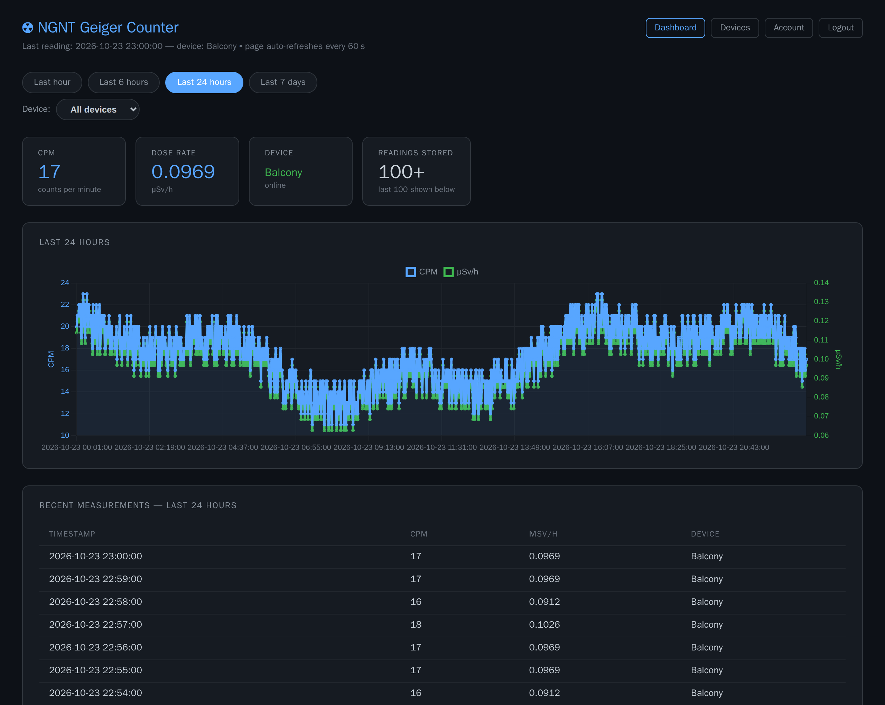

# not great, not terrible — geiger counter

A DIY radiation monitor: a RadiationD v1.1 Cajoe sensor, a Wemos D1 R2 (ESP8266) and a 20x4 I2C LCD in a 3D-printed case. It publishes counts per minute over MQTT (TLS) to a self-hosted Docker stack with a web dashboard, user accounts and device provisioning in the browser.



**Status: v3.5.** Hardware, firmware v2.2 and the dockerized backend are done; CI runs pytest, pip-audit, the end-to-end suite and the screenshot tour. Open ideas are at the end.


Every screen of the web UI, with a line each: [screenshot gallery](docs/screenshots/README.md). The dashboard [on a phone](docs/screenshots/dashboard.mobile.png).

Step by step: [user guide](docs/user-guide.md) (account, dashboard, adding your counter) · [admin guide](docs/admin-guide.md) (settings, users, backups, upgrades, reset).

**Contents:** [Features](#features) · [Hardware](#hardware) · [Firmware](#firmware--geiger_counter_v22ino) · [Server quick start](#server-quick-start) · [Device provisioning](#device-provisioning-auto-provisioning-via-web-ui) · [Backend](#backend--ngnt-geiger-dockerized) · [Running tests](#running-tests) · [Screenshots](#screenshots) · [Repository layout](#repository-layout) · [Security notes](#security-notes) · [Open ideas](#open--future-ideas)

---

## Features

### Device

- **Measurement**: counts per minute and dose rate (µSv/h), published every 60 s over MQTT with TLS, aligned to wall-clock minutes.
- **No typed credentials**: the firmware generates its pepper on first boot and derives its MQTT login from MAC + pepper.
- **Info screen**: after 12 failed MQTT attempts the LCD shows MAC, MQTT user ID and pepper for 2 minutes.
- **Setup portal**: WiFi, MQTT server, timezone and tube constants are set in a WiFiManager captive portal, no re-flash.

### Web dashboard

- **Dashboard**: latest CPM and dose rate, online status, a chart over the last hour, 6 hours, 24 hours or 7 days and the latest 100 readings. Reloads every 60 s and fits a phone.
- **Device filter**: with two or more visible counters, one counter's readings at a time.
- **Alert colour**: the dose-rate card turns orange above the alert threshold (admin setting, default 0.5 µSv/h).
- **Visibility**: each user's counters are public or private; see [who sees which counters](docs/admin-guide.md#who-sees-which-counters).
- **Accounts**: registration (admins can close it), password reset by email, and a password change that signs out your other sessions.
- **Device provisioning**: register a counter by its MAC; Mosquitto accepts it within 5 seconds.
- **Admin panel**: global settings, SMTP and the user list (role, visibility, delete with all devices).
- **Hardening**: CSRF tokens on every form, rate-limited login, registration and password reset, no device password in the database.

---

## Hardware

### Parts list

| Qty | Part |
|-----|------|
| 1 | RadiationD v1.1 Cajoe (search "diy geiger" on auction sites) |
| 1 | Wemos D1 R2 (ESP8266) |
| 1 | LCD2004 with I2C interface (buy one with the I2C backpack already soldered on) |
| 1 | 3D-printed case — [Printables model 399474](https://www.printables.com/model/399474-ngnt-geiger-counter-not-great-not-terrible) |
| 7 | M-F Dupont cables |
| 8 | M3x8 mm screws + nuts |
| 4 | M3x12 mm screws + nuts |
| 4 | M3 spacers >=35 mm + matching screws + nuts |

### Assembly

1. Print the front and back plates.
2. Mount the Wemos to the back plate (4x M3x8 mm + nuts).
3. Mount the LCD to the front plate (4x M3x12 mm + nuts).
4. Remove the 4 acrylic-retaining screws from the RadiationD; mount the board to the front plate (4x M3x8 mm).
5. Connect Dupont cables per the pinout below.
6. Use M3 spacers, screws, and nuts to join front and back plate.
7. Flash the firmware (see below).

### Wiring

**LCD -> Wemos D1 R2**

| LCD | Wemos |
|-----|-------|
| GND | GND |
| VCC | 3.3 V |
| SDA | D2 (SDA) |
| SCL | D1 (SCL) |

**RadiationD v1.1 -> Wemos D1 R2**

| RadiationD | Wemos |
|------------|-------|
| GND | GND |
| 5 V | 5 V |
| VIN | D6 (GPIO 12) |

---

## Firmware — `geiger_counter_v2.2.ino`

### Required Arduino libraries

Install these via the Arduino IDE Library Manager:

| Library | Version tested |
|---------|---------------|
| [LiquidCrystal_I2C](https://github.com/johnrickman/LiquidCrystal_I2C) | any |
| [WiFiManager](https://github.com/tzapu/WiFiManager) | 2.0.17 |
| [ezTime](https://github.com/ropg/ezTime) | 0.8.3 |
| [PubSubClient](https://pubsubclient.knolleary.net/) | 2.8.0 |
| [ArduinoJson](https://arduinojson.org/) | 7.4.3 (6.21.6 also builds) |

Board support: **ESP8266 Arduino core >= 3.0.0** (`esp8266` board package in the IDE); built against 3.1.2 for the Wemos D1 R2 & mini.

### Configuration

#### Compile-time only (edit before flashing)

```cpp
const String deviceHostname = "GeigerCounter"; // WiFi AP name & mDNS hostname
const String wifiApPass     = "wifiApPass";    // password for the setup AP
const char* lcdDateTimeFmt  = "d.m.y    H:i:s"; // date+time format on the LCD
```

#### Configurable via the WiFiManager portal (no re-flash needed)

| Field | Default | Notes |
|-------|---------|-------|
| MQTT Server | `your.server.address` | your server's hostname or IP |
| MQTT Port | `8883` | TLS port; `MOSQUITTO_PORTS_TLS` in `.env` |
| MQTT User | `geiger00` | leave at default for auto-provisioning |
| MQTT Password | `geiger00PW` | leave at default for auto-provisioning |
| MQTT Pepper | *(auto-generated)* | auto-generated on first boot if empty; must match your user's pepper in the web UI |
| Timezone | `Europe/Vienna` | [tz database name](https://en.wikipedia.org/wiki/List_of_tz_database_time_zones) |
| CPM Factor (uSv/h) | `0.0057` | Conversion constant for your GM tube |
| Dead time (us) | `200` | ISR debounce (200 for SBM-20, 50-90 for J305) |

### What the firmware does

- **Pepper**: on first boot without one, it generates 8 random hex chars (hardware RNG) and saves them to flash.
- **Setup portal**: without saved WiFi credentials it opens an access point (`GeigerCounter` / `wifiApPass`) with a captive portal. The pepper field is pre-filled.
- **Connect**: it synchronises time via NTP, then connects to the MQTT broker.
- **Info screen**: after 12 failed MQTT attempts the LCD shows the MAC address, MQTT user ID and pepper for 2 minutes (use them to register the device in the web UI), then it retries.
- **Publish**: every 60 seconds a JSON measurement goes to `/<device_id>/impulses`, clock-aligned to wall-clock minutes.

**MQTT message format** (published every 60 s):
```json
{"id":"geiger_aabbcc","ts":"2026-02-24 14:30:00","cpm":42,"usvh":0.2394}
```

---

## Server quick start

**1. Clone and configure**
```bash
git clone https://github.com/phoen-ix/ngnt-geiger-counter.git
cd ngnt-geiger-counter/ngnt-geiger-dockerized

cp .env.example .env
# Edit .env — change all passwords, FLASK_SECRET_KEY, and SITE_NAME before proceeding
```

**2. Start the stack**
```bash
docker compose up -d --build
```

On first start:
- MariaDB runs `dbinit.sql` and creates all tables
- Flask creates an `admin` user with a random password and saves it to `data/admin_initial_password.txt` (never to the logs)

**3. Get the admin password**
```bash
# the file belongs to root, mode 0600
docker compose exec ngnt-geiger-flask cat /app/data/admin_initial_password.txt
```

**4. Log in and configure**

Open `http://<your-server>:1880`, log in as `admin`, change the password and set the **Base URL**, SMTP and the other settings: [admin guide, first sign-in](docs/admin-guide.md#first-sign-in).

**5. Register devices**

Users create accounts, set their pepper and register their counters: [user guide, adding your counter](docs/user-guide.md#adding-your-counter).

---

## Device provisioning (auto-provisioning via web UI)

Since v3.0 the web UI provisions devices (the manual `add-device.sh` script is gone). The steps, from the counter's setup portal to the **Devices** page: [user guide](docs/user-guide.md#adding-your-counter).

**How it works:**
- Firmware and server both compute `username = geiger_<last 6 hex of MAC>` and `password = HMAC-SHA256(pepper, mac)[:16]`.
- The pepper is stored per user, so different users can have different peppers.
- The server keeps no device password: Mosquitto gets only its hash (`devices.conf`, Mosquitto's `$7$` format), and the database stores none.

---

## Backend — `ngnt-geiger-dockerized/`

Four Docker containers:

```
Geiger counter
     |  WiFi / MQTT (TLS, port 8883)
     v
+-----------------+        +------------------+
|   Mosquitto     |------->|  Python          |
|  MQTT broker    |        |  subscriber      |
|  :8883 (TLS)    |        +--------+---------+
|  :2883 (plain)  |                 | INSERT
+-----------------+                 v
                           +------------------+
                           |    MariaDB       |
                           |  :3306 (internal)|
                           +--------+---------+
                                    | SELECT
                                    v
                           +------------------+
                           |  Flask/Gunicorn  |
                           |  dashboard :1880 |
                           +------------------+
```

Setup: [Server quick start](#server-quick-start).

### Visibility, backups, upgrades and reset

Who sees which counters, what to back up, upgrading (MariaDB, older versions) and wiping all data: [admin guide](docs/admin-guide.md#who-sees-which-counters).

### Container overview

| Container | Image / Dockerfile | Exposes | Role |
|-----------|-------------------|---------|------|
| `ngnt-geiger-mariadb` | `mariadb:12.3.3` | 3306 (internal) | Persistent storage |
| `ngnt-geiger-mosquitto` | `DockerfileMosquitto` (`eclipse-mosquitto:2.1.2-alpine` + openssl) | 8883 (TLS), 2883 -> 1883 (plain) | MQTT broker with TLS + auto-reload |
| `ngnt-geiger-subscriber` | `DockerfileSubscriber` (`python:3.15.2-slim-trixie`) | — | Async MQTT subscriber -> DB |
| `ngnt-geiger-flask` | `DockerfileFlask` (`python:3.15.2-slim-trixie`) | 1880 -> 8000 | Flask web dashboard + user management |

All containers share the internal bridge network `10.188.1.0/24` (`IPV4_NETWORK` in `.env`). It must not overlap any other Docker network on the host; the subscriber reaches MariaDB (`.20`) and Mosquitto (`.30`) by these fixed addresses.

---

## Running tests

The test suite runs on the host (no Docker needed) and uses mocked DB connections — no external dependencies required.

```bash
cd ngnt-geiger-dockerized
pip install -r app/requirements-dev.txt
python -m pytest -v
```

It covers every route and the middleware (session checks, CSRF, rate limiting); `python -m pytest --collect-only -q` lists the tests.

### E2E

The Playwright suite in `ngnt-geiger-dockerized/e2e/tests/` drives the whole stack in a browser: every page as guest, user and admin, and each feature end to end. [`e2e/COVERAGE.md`](ngnt-geiger-dockerized/e2e/COVERAGE.md) maps every feature to its test.

- **Accounts:** sign-up, sign-in, password reset through a real mail (Mailpit).
- **Devices:** registered in the UI, then publishing over MQTT/TLS through Mosquitto and the subscriber into the dashboard.
- **The rest:** the account and admin pages, the rate limits.

```bash
cd ngnt-geiger-dockerized/e2e && npm ci && npx playwright install chromium && cd ..
scripts/e2e.sh                                       # the whole suite
PORT_BASE=24800 scripts/e2e.sh --grep devices        # another port block, some tests
```

- **Needs** Docker and Node 26; reads `.env.example` and keeps its state in named volumes.
- **Runs** as compose project `ngnt-geiger-counter_e2e` on `127.0.0.1:${PORT_BASE:-1880}` (Mailpit on +5, MQTT/TLS on +8) and tears the stack down when it ends.
- **CI** runs it on every push.

---

## Screenshots

Every screenshot here comes from the docs tour in `ngnt-geiger-dockerized/e2e/docs/`: it starts a throwaway Flask + MariaDB stack, seeds fictional users, three counters and a day of readings, and photographs each screen. The [gallery](docs/screenshots/README.md) shows them all with a line on what each screen does.

```bash
cd ngnt-geiger-dockerized/e2e && npm ci && npx playwright install chromium && cd ..
scripts/docs-screenshots.sh                          # writes ../docs/screenshots/*.png
PORT_BASE=24800 scripts/docs-screenshots.sh /tmp/shots   # another port / output dir
```

- **Needs** Docker and Node 26.
- **Isolated:** runs as compose project `ngnt-geiger-counter_docs` on `127.0.0.1:${PORT_BASE:-1880}`, reads `.env.example` (never `.env`) and keeps its data in named volumes. It does not touch a local instance in the same checkout; pass another `PORT_BASE` if that one uses port 1880.
- **Timestamps:** the readings end at the start of the current UTC hour, so a run in another hour changes the dashboard's timestamps.
- **CI** runs the tour on every push as a render check; the **Docs screenshots** workflow (Actions, manual) returns the PNGs as an artifact.

---

## Repository layout

```
ngnt-geiger-counter/
├── geiger_counter_v2.2.ino          # ESP8266 firmware (Wemos D1 R2)
├── HANDOVER.md                      # Technical handover: design, schema, decisions
├── docs/user-guide.md, admin-guide.md  # Step-by-step manuals
├── docs/screenshots/                # Web UI screenshots + gallery (generated)
└── ngnt-geiger-dockerized/
    ├── app/                         # Flask web application
    │   ├── app.py                   # Routes, schema migration, admin bootstrap
    │   ├── helpers.py               # Credential derivation, provisioning, auth
    │   ├── requirements.txt         # Production deps (pinned)
    │   ├── requirements-dev.txt     # Adds pytest for local testing
    │   ├── static/style.css
    │   └── templates/               # Jinja2 templates
    ├── tests/                       # pytest suite (mocked DB)
    │   ├── conftest.py              # Fixtures (app, client, auth, admin)
    │   ├── testutils.py             # MockCursor, MockDB, queue helpers
    │   └── test_*.py
    ├── e2e/                         # Playwright docs tour + e2e suite (own Node package)
    ├── pytest.ini
    ├── dbinit.sql                   # DB schema — auto-applied on first start
    ├── config/                      # Static config for Mosquitto & MariaDB
    ├── docker-compose.yml
    ├── docker-compose.e2e.yml       # Overlay for throwaway stacks (docs tour, e2e)
    ├── Dockerfiles/
    ├── scripts/
    │   ├── docs-screenshots.sh      # Regenerates docs/screenshots/
    │   ├── e2e.sh                   # Runs the e2e suite against a throwaway stack
    │   ├── mosquitto/               # Container entrypoint (passwords + reload watcher)
    │   └── pm2/                     # Python MQTT→DB subscriber
    ├── data/                        # Runtime data (admin initial password)
    ├── volumes/                     # Runtime DB data — safe to wipe for a reset
    ├── .env.example                 # Copy to .env and fill in before first run
    └── log/mosquitto/
```

Design, schema and decisions: [HANDOVER.md](HANDOVER.md).

---

## Security notes

- **MQTT TLS**: the firmware uses `WiFiClientSecure::setInsecure()`. It encrypts traffic, which stops passive eavesdropping of MQTT credentials over WiFi, but does not verify the server certificate, so it does not stop an active man-in-the-middle. Acceptable for a home network.
- **Plain MQTT listener** (port 2883 -> 1883): stays available for un-updated devices and container-to-container traffic.
- **Device credentials**: `devices.conf` and `passwd.txt` hold only Mosquitto password hashes, are gitignored and are managed at runtime by Flask provisioning and the Mosquitto entrypoint.
- **Pepper**: stored in plaintext in the database, because the server needs it to derive credentials. Anyone who can read the database can derive every device's MQTT password from its MAC and the owner's pepper.
- **Initial admin password**: written only to `data/admin_initial_password.txt` (mode 0600), never to the logs.
- **Flask secret key**: `FLASK_SECRET_KEY` is mandatory; the app refuses to start without it.
- **DB connection pooling**: Flask uses `DBUtils.PooledDB` to recycle MariaDB connections instead of opening one per request.
- **Mosquitto logging**: `warning` level. Switch to `debug` in `config/mosquitto/conf.d/mosquitto_addons.conf` only when troubleshooting.

## Open / future ideas

- Front plate revision: cutouts for two toggle switches (LCD backlight, speaker mute)
- Web dashboard: CSV/JSON data export
- Grafana integration (MariaDB datasource)
