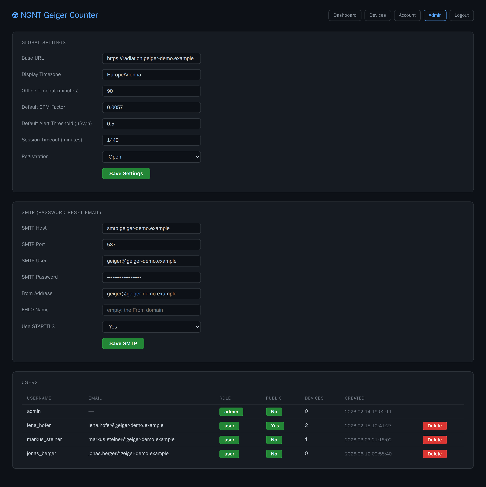

# Geiger counter admin guide

The admin's tasks in the web dashboard, plus backups, upgrades and a reset of the Docker stack.

Audience: users with the **admin** role, and whoever runs the server. Installing the stack: [README](../README.md#server-quick-start). Everyday use (dashboard, adding a counter): [user guide](user-guide.md). Every screen: [screenshot gallery](screenshots/README.md).

**Contents:** [What admins can do](#what-admins-can-do) · [First sign-in](#first-sign-in) · [Global settings](#global-settings) · [Password-reset email (SMTP)](#password-reset-email-smtp) · [Managing users](#managing-users) · [Who sees which counters](#who-sees-which-counters) · [Backups](#backups) · [Upgrading](#upgrading) · [Reset](#reset)

## What admins can do

Everything sits on one page, **Admin** in the top bar, at `/admin`. The role checks in the code:

| What | Check |
|------|-------|
| **Admin** link in the top bar | `session.role == 'admin'` (`base.html`) |
| `/admin` (settings, SMTP, users) | `@admin_required`: signed out goes to `/login`, other roles to the dashboard |
| Every counter on the dashboard | `role == 'admin'` in `dashboard()` |

The role is read from the database on every request, so a role change applies at the user's next page load. Admins use **Devices** and **Account** like everyone else ([user guide](user-guide.md)).



## First sign-in

On its first start the stack creates the user `admin` with a random password and writes it only to `data/admin_initial_password.txt` (owned by root, mode 0600), never to the logs.

1. Read the password ([README, step 3](../README.md#server-quick-start)): `docker compose exec ngnt-geiger-flask cat /app/data/admin_initial_password.txt`
2. Open `http://<your-server>:1880`, click **Login** and sign in as `admin`.
3. **Account** → **Change Password**: set your own. This deletes `admin_initial_password.txt`.
4. **Admin** → **Global Settings**: set **Base URL** to the address users open, e.g. `https://geiger.example.com`. Click **Save Settings**.
5. If users should be able to reset forgotten passwords, set up [SMTP](#password-reset-email-smtp).

The name in the header and in emails is `SITE_NAME` in `.env`, not an admin setting.

## Global settings

**Admin** → **Global Settings**, then **Save Settings**. An invalid value is rejected with a message and nothing is saved.

| Setting | Default | Effect |
|---------|---------|--------|
| **Base URL** | empty | Start of the link in password-reset emails. Empty: the link points to `http://localhost:8000`, which no user can open. |
| **Display Timezone** | `Europe/Vienna` | Timestamps on the dashboard, **Devices** and the user list. A tz database name such as `Europe/Berlin`. |
| **Offline Timeout (minutes)** | `5` | A counter shows as offline when its last message is older than this, or when the broker reported it gone. |
| **Default CPM Factor** | `0.0057` | Greyed out: each counter converts CPM to µSv/h itself (**CPM Factor** in its setup portal). |
| **Default Alert Threshold (μSv/h)** | `0.5` | Above this the dashboard's **Dose rate** card turns orange. |
| **Session Timeout (minutes)** | `1440` | How long a sign-in lasts after the user's last page load. |
| **Registration** | **Open** | **Disabled**: the **Register** page sends visitors back to the login page with **Registration is currently disabled.** |

There is no form to create a user: people register themselves. To add someone while registration is disabled, set it to **Open** until they have registered.

## Password-reset email (SMTP)

**Admin** → **SMTP (Password Reset Email)**, then **Save SMTP**.

| Field | Default | Notes |
|-------|---------|-------|
| **SMTP Host** | empty | Empty: no reset mail is sent. |
| **SMTP Port** | `587` | |
| **SMTP User**, **SMTP Password** | empty | Leave **SMTP User** empty for a server without login. |
| **From Address** | empty | Empty: the **SMTP User** is the sender. |
| **Use STARTTLS** | **Yes** | **No** sends without encryption (e.g. a relay on port 25). There is no implicit-TLS mode for port 465. |

To test, enter an email address under **Account**, sign out and use **Forgot password?** with your username. A mail that fails is only logged (`docker logs ngnt-geiger-flask`, line `[email] send failed`); the page shows the same answer either way. The link is valid for one hour. Only users with an email address in their account get one.

## Managing users

**Admin** → **Users** lists every account with **Email**, **Role**, **Public**, the number of **Devices** and when it was **Created**.

- **Make someone admin or user:** click the button in **Role** (it shows the current role). Your own role button is disabled.
- **Show or hide someone's counters:** click the button in **Public** (**Yes**/**No**). This is the same setting as **Public profile** on that user's **Account** page.
- **Delete a user:** click **Delete** and confirm. The broker stops accepting their counters, the account and its counters are removed, and the user is signed out at their next request. Their stored readings stay in the database but no longer appear. There is no **Delete** on your own row.

You can't edit another user's email, pepper or password. A user who forgot their password and has no email address can't get back in; they can register a new account.

## Who sees which counters

| Who | Sees on the dashboard |
|-----|-----------------------|
| Visitors (not signed in) | Counters of users whose profile is public |
| Signed-in users | Their own counters plus all public ones |
| Admins | Every counter |

New accounts start private. **Devices** always lists only your own counters, also for admins.

## Backups

The state lives in the checkout's `ngnt-geiger-dockerized/` directory:

| What | Where | Holds |
|------|-------|-------|
| Database | `volumes/mariadb/` (MariaDB `ngnt-geigercounter`) | Users, counters, settings (incl. SMTP password), readings |
| Device logins | `config/mosquitto/devices.conf` | One password hash per registered counter; the broker reads it at start-up |
| Configuration | `.env` | Database and MQTT passwords, `FLASK_SECRET_KEY` |
| TLS certificate | `volumes/mosquitto/certs/` | Self-signed, made on first start. Counters don't check it, so a new one works too. |

`data/` holds only the initial admin password, `volumes/mosquitto/data/` nothing (persistence is off). Back up the database with a dump; copying `volumes/mariadb/` while it runs is not safe. In `ngnt-geiger-dockerized/`:

```bash
docker compose exec -T ngnt-geiger-mariadb sh -c \
  'mariadb-dump -uroot -p"$MARIADB_ROOT_PASSWORD" --single-transaction --routines --events --databases ngnt-geigercounter' \
  > geiger-$(date +%F).sql
sudo cp config/mosquitto/devices.conf .env /path/to/backup/
```

`--routines --events` keep the procedure and the monthly event that add new partitions to the readings table.

**Restore** (on this or a fresh checkout):

1. `docker compose down`
2. Put `.env` and `config/mosquitto/devices.conf` back.
3. `docker compose up -d ngnt-geiger-mariadb` and wait until `docker compose logs ngnt-geiger-mariadb` shows `ready for connections`.
4. Import the dump:
   ```bash
   docker compose exec -T ngnt-geiger-mariadb sh -c 'mariadb -uroot -p"$MARIADB_ROOT_PASSWORD"' < geiger-2026-11-06.sql
   ```
5. `docker compose up -d`

The dump replaces the tables. Keep `devices.conf` and the database from the same time: a counter registered after the backup is missing from both.

## Upgrading

Take a [backup](#backups) first. Then, in `ngnt-geiger-dockerized/`:

```bash
git pull
docker compose up -d --build --force-recreate
```

`--force-recreate` matters: the web app and the subscriber run from the mounted checkout, so only a new container picks up their code. On start Flask applies the schema changes an older database lacks.

### MariaDB

- **Version:** `DOCKER_IMAGE_MARIADB_TAG` in `.env` (`.env.example` ships `12.3.3`). An existing install keeps its own value until you change it.
- **In-place upgrade:** the service sets `MARIADB_AUTO_UPGRADE=1`, so after raising the tag the container upgrades `volumes/mariadb` on its first start.
- **Dump first:** a major-version upgrade cannot be rolled back.

### Stored device passwords (from v3.5 or earlier)

On its next start Flask removes the device passwords older versions kept:

- **Database:** v3.0–3.5 wrote each device's MQTT password in plaintext into `devices.mqtt_password` (never read). The column is dropped.
- **`devices.conf`:** plaintext `device_id password` lines from v3.4 or earlier become Mosquitto hashes.

Registered counters keep working: their login is derived from MAC + pepper as before.

### Leftovers in `app/` (from v3.4 or earlier)

Older versions mounted `app/` read-write at `/app` with `data/` and `config/mosquitto/` nested inside. Docker left root-owned `app/data/`, `app/mosquitto-config/` (empty mount points) and `app/__pycache__/` in the checkout. The app is now mounted read-only at `/src`. After pulling, recreate the container and remove them once:

```bash
docker compose up -d ngnt-geiger-flask
sudo rm -rf app/data app/mosquitto-config app/__pycache__
```

## Reset

Wipes all users, counters, readings and device logins and starts like a new install (a new `admin` password in `data/`). The containers write these files as root and the MariaDB user, hence `sudo`:

```bash
docker compose down
sudo rm -rf volumes/mariadb/* volumes/mosquitto/data/* volumes/mosquitto/certs/* data/ config/mosquitto/devices.conf
docker compose up -d
```

`devices.conf` has to go too: Flask skips a counter whose ID is already in it, so a counter registered again with another pepper would keep its old, now wrong, login.
