# Screenshots

The web dashboard of `ngnt-geiger-dockerized/`, one section per screen. The data is fictional: users on
`geiger-demo.example`, three counters and a day of readings, seeded by the docs tour
(`ngnt-geiger-dockerized/e2e/docs/`). Regenerate with `ngnt-geiger-dockerized/scripts/docs-screenshots.sh`
(see the main [README](../../README.md#screenshots)).

## Dashboard

The start page (`/`): the latest reading's CPM and dose rate, the reporting device and whether it is online, a chart
of the selected range (last hour, 6 hours, 24 hours, 7 days) and the latest 100 readings below it. Visitors see the
counters of public users, signed-in users also their own, admins all of them. The page reloads every 60 s.

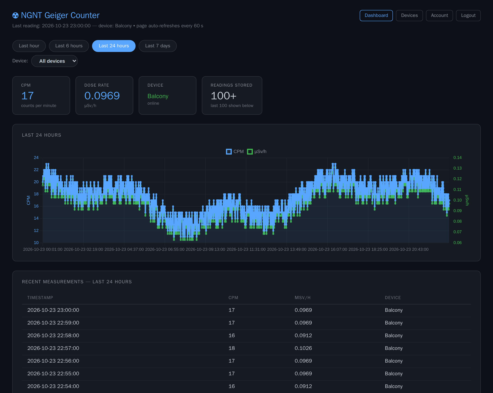

## Dashboard — phone

The same page on a phone (390 px wide): the header and the form fields stack, the cards share a row, and wide tables
scroll inside their box.

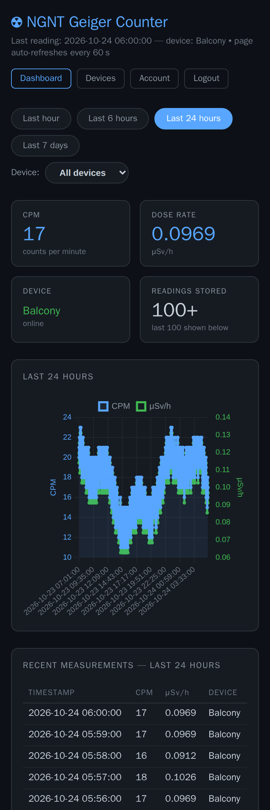

## Dashboard — one device, offline

With more than one visible counter, the **Device** dropdown narrows the page to one. This one was unplugged two days
ago: the cards keep its last reading, it shows as offline, and the 24-hour range has no readings.

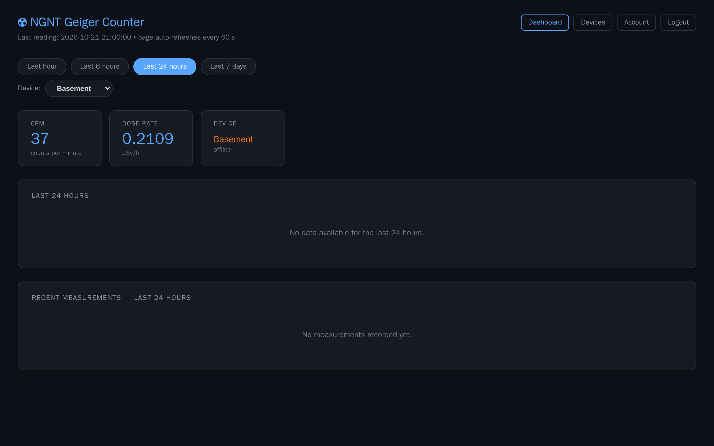

## Login

`/login`, with links to password reset and registration.

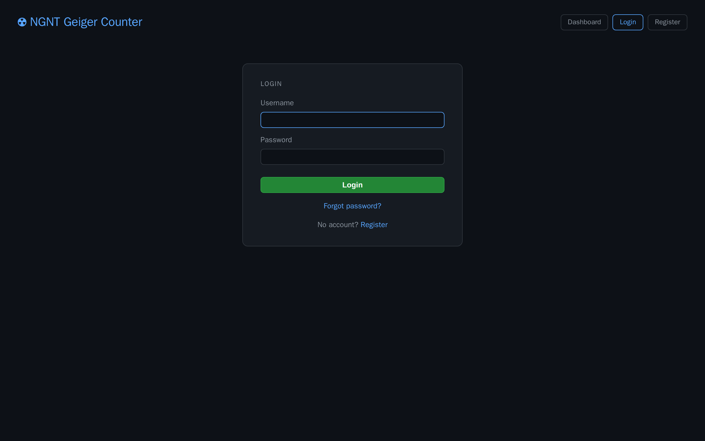

## Login — wrong password

A failed login shows a message that does not tell whether the user exists.

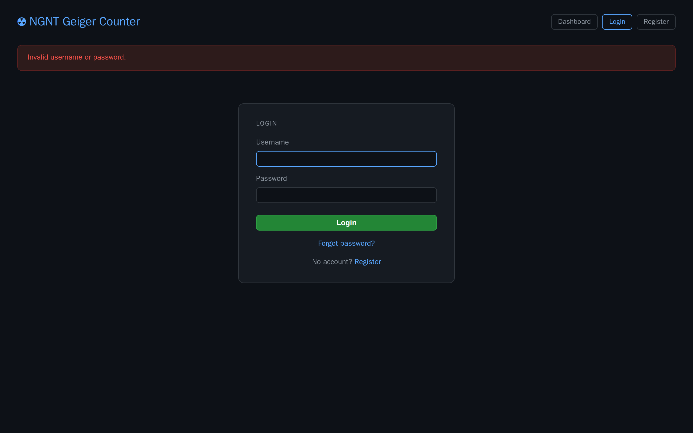

## Register

`/register` creates a normal user (email optional). Admins can close registration in the admin settings.

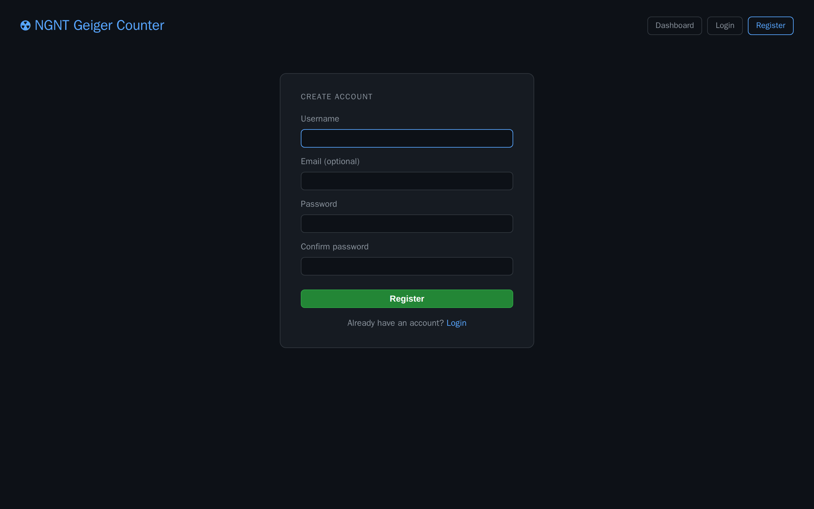

## Forgot password

`/forgot-password` emails a reset link valid for one hour, if the account has an email address and SMTP is
configured. The answer is the same either way.

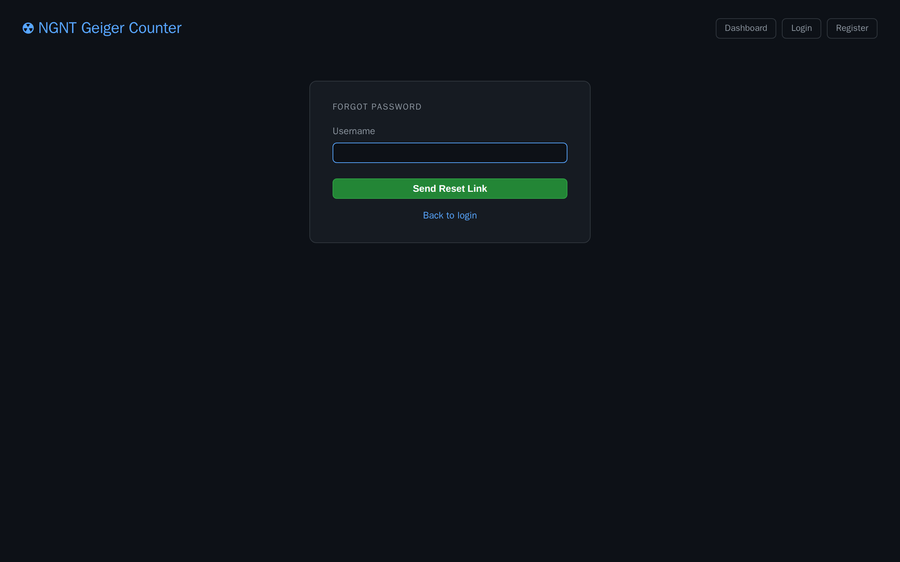

## Reset password

The page the emailed link opens (`/reset-password/<token>`).

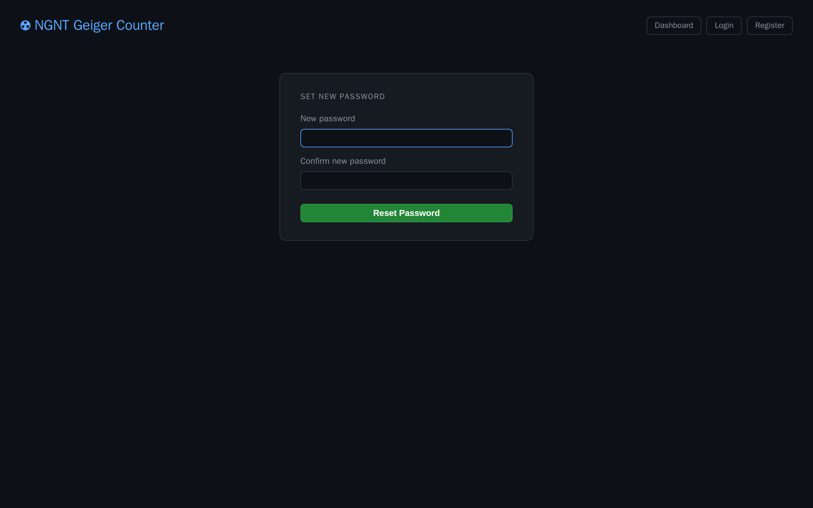

## Devices

`/devices`: register a counter by its WiFi MAC address (the server derives its MQTT login from the MAC and your
pepper and provisions Mosquitto), rename or delete your counters, and see their status and last contact (in the display timezone).

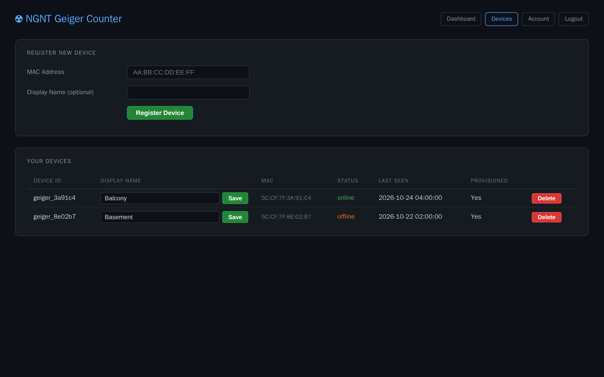

## Devices — no pepper yet

A new account has to set the MQTT pepper shown on the counter's LCD in its account settings before it can register
a device.

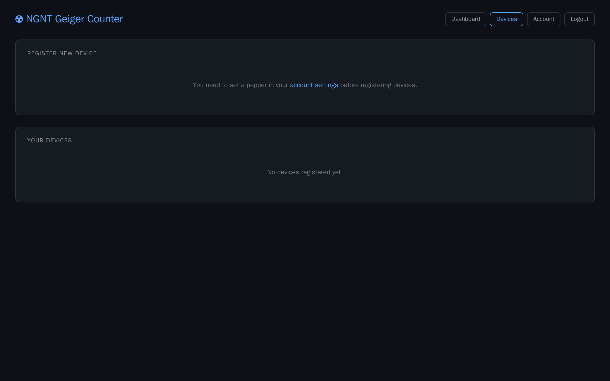

## Account

`/account`: email, MQTT pepper, whether others may see your counters, and the password change (which signs out your
other sessions).

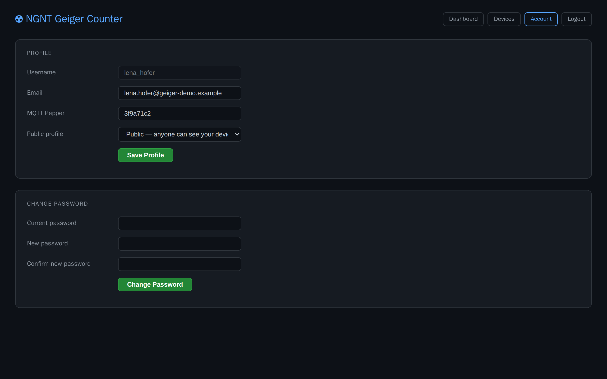

## Admin

`/admin` (admins only): global settings (base URL for reset links, display timezone, offline timeout, alert
threshold, session timeout, registration), SMTP for password-reset email, and the user list where admins switch a
user's role or visibility or delete the user with all their devices.

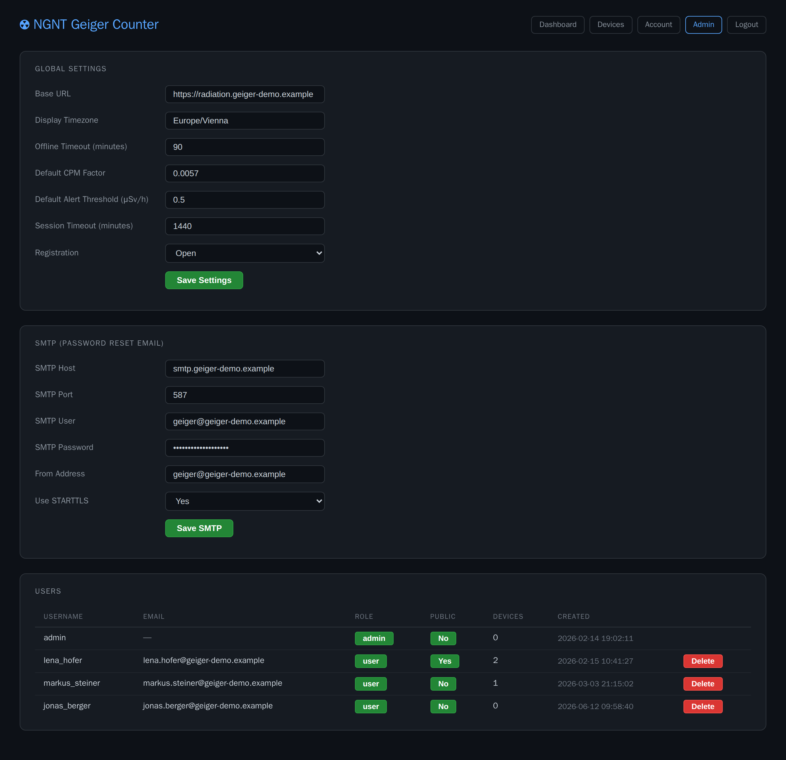
