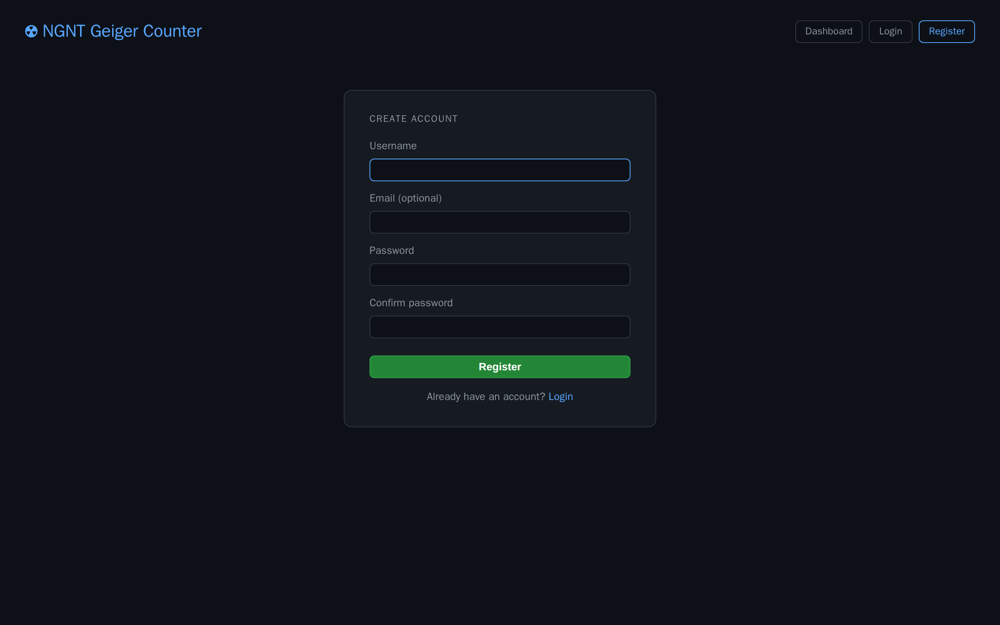
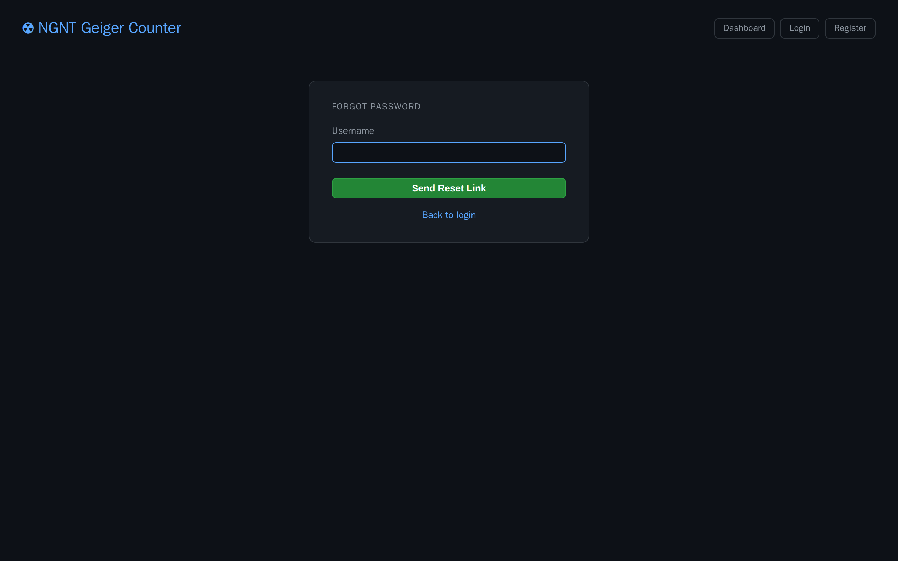
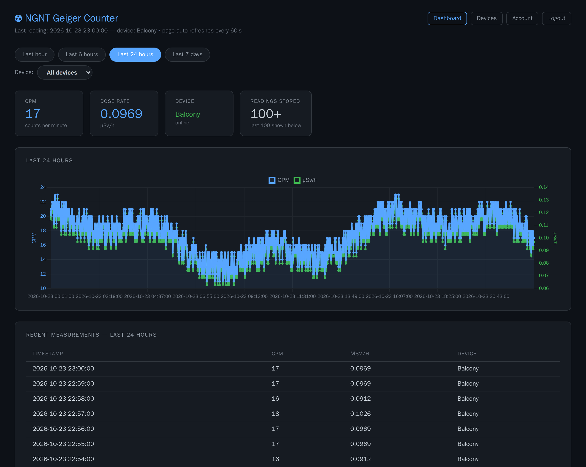
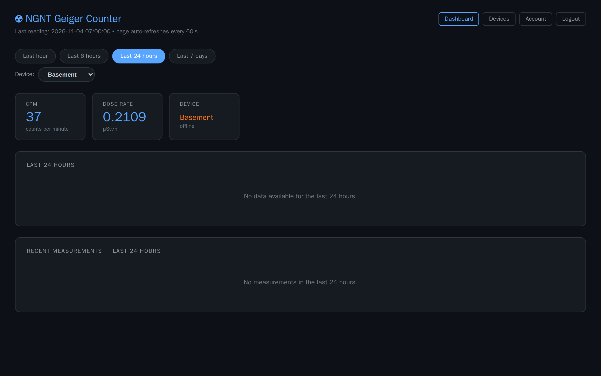
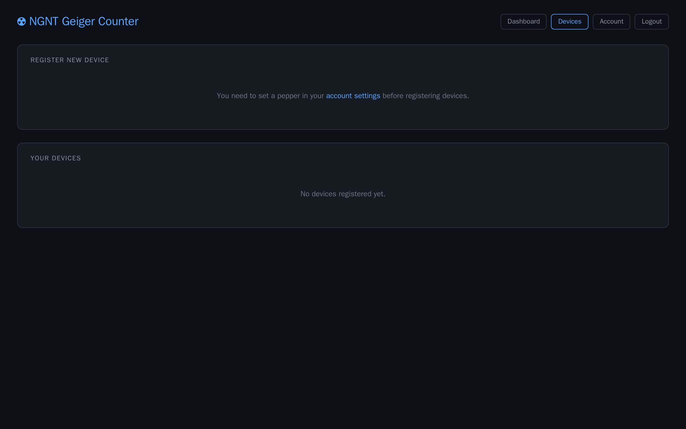
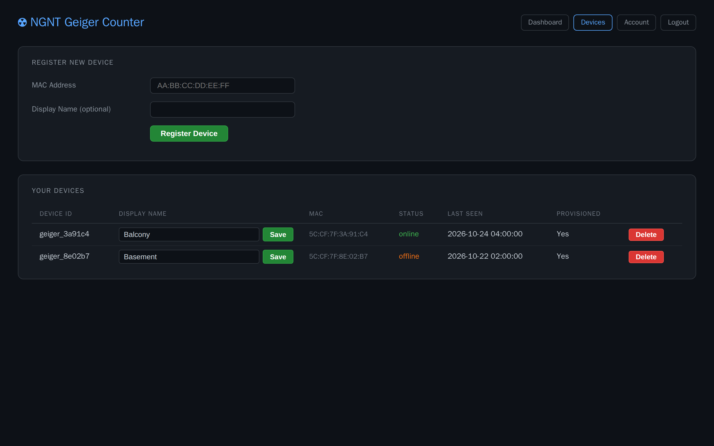
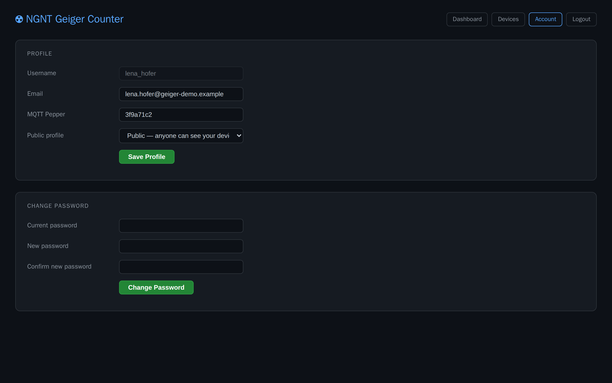

# Geiger counter user guide

How to use the web dashboard and connect your own counter to it, step by step.

Audience: anyone with an account on the dashboard, and visitors without one. Admins: see also the [admin guide](admin-guide.md).
Building and flashing a counter, installing the server: [README](../README.md). Every screen: [screenshot gallery](screenshots/README.md).

**Contents:** [Creating an account](#creating-an-account) · [Signing in and out](#signing-in-and-out) · [Resetting a forgotten password](#resetting-a-forgotten-password) · [Reading the dashboard](#reading-the-dashboard) · [Adding your counter](#adding-your-counter) · [What the counter's display shows](#what-the-counters-display-shows) · [Renaming or removing a counter](#renaming-or-removing-a-counter) · [Choosing who sees your counters](#choosing-who-sees-your-counters) · [Changing your email or password](#changing-your-email-or-password)

## Creating an account

1. Click **Register** in the top bar.
2. Enter a **Username**: 3 to 50 characters, letters, digits, `_` and `-` only. You can't change it later.
3. **Email (optional)**: needed only if you want to reset a forgotten password by email.
4. Enter a **Password** (at least 6 characters) twice and click **Register**.
5. You land on the login page with **Account created. Please log in.**



If the page answers **Registration is currently disabled.**, the admin has closed sign-ups: ask them.

## Signing in and out

1. Click **Login**, enter **Username** and **Password**, click **Login**.
2. A wrong username or password gives **Invalid username or password.** After 10 tries in a minute, wait a minute.

You stay signed in until you click **Logout** or until the session timeout the admin set runs out (24 hours by default, counted from your last page load). Changing your password signs out your other browsers.

## Resetting a forgotten password

1. On the login page click **Forgot password?**
2. Enter your **Username** and click **Send Reset Link**.
3. Open the email and follow its link within one hour.
4. Enter the **New password** twice and click **Reset Password**.



The page always answers **If that account exists and has an email, a reset link has been sent.** No mail arrives if your account has no email address or the admin hasn't set up email: ask the admin then.

## Reading the dashboard

**Dashboard** is the start page; it works without signing in.



- **Which counters:** visitors see the counters of users with a public profile; signed in, you also see your own; admins see all.
- **Range:** **Last hour**, **Last 6 hours**, **Last 24 hours** (default) or **Last 7 days** sets the chart and the table.
- **Device:** with two or more counters visible, pick one in the **Device** dropdown, or **All devices**.
- **Cards:** **CPM** (counts per minute) and **Dose rate** (µSv/h) of the newest reading; the dose rate turns orange above the alert threshold (0.5 µSv/h unless the admin changed it). **Device** names the counter and says **online** (green) or **offline** (orange). **Readings stored** counts the readings in the range, up to **100+**.
- **Table:** the newest 100 readings of the range, in the admin's display timezone.

The page reloads every 60 seconds. A counter counts as offline when it has sent nothing for longer than the admin's offline timeout (5 minutes by default) or the broker has reported it gone; its cards keep the last reading:



On a phone the same page stacks: [screenshot](screenshots/dashboard.mobile.png).

## Adding your counter

The counter logs in to the server with a name and password it derives from its WiFi MAC address and a shared secret, the **pepper**. You give the server the same two values; nobody types a password. You need an account, the counter, and the server address and MQTT port from your admin (port `8883` unless they changed it).

### 1. Connect the counter to your WiFi

1. Power the counter. Without saved WiFi its display shows **AccessPoint:**, **Name GeigerCounter** and **Pass wifiApPass** (whoever built it may have set other values).
2. On your phone or laptop, join that WiFi network with that password. The setup portal opens.
3. Choose your WiFi network and enter its password.
4. Fill in **MQTT Server** (the server address) and **MQTT Port**. Set **Timezone** for the clock on the display (a name like `Europe/Vienna`). Leave **MQTT User** and **MQTT Password** as they are: with any other values the counter doesn't derive its login. Leave **CPM Factor (uSv/h)** and **Dead time (us)** unless your tube needs other values ([README](../README.md#configurable-via-the-wifimanager-portal-no-re-flash-needed)).
5. **MQTT Pepper** is pre-filled with a random value the counter made on its first start. Keep it, or, if you already have counters, replace it with the pepper in your account so one pepper serves them all.
6. Save. The counter joins your WiFi, shows **Syncing time...** and tries to reach the server.

### 2. Read the MAC address and pepper off the display

The server doesn't know the counter yet, so the counter shows **Connection Error** with **Attempt 1 of 12**, **Attempt 2 of 12**, and so on. When the attempts are used up, it shows for 2 minutes:

```
MQTT connect failed
5C:CF:7F:3A:91:C4      <- MAC address
ID geiger_3a91c4       <- its device ID
3f9a71c2               <- pepper
```

Write down the MAC address and the pepper (with the counter on USB, the serial monitor at 115200 baud prints the same). Then it tries again and comes back to this screen after the next round.

### 3. Set your pepper

1. Click **Account**.
2. Enter the pepper in **MQTT Pepper** (up to 64 characters, ASCII letters, digits and symbols) and click **Save Profile**.

Your account holds one pepper. A counter registered earlier keeps working when you change it later; a counter you register afterwards needs the new one.



Without a pepper, **Devices** asks you to set one first.

### 4. Register the counter

1. Click **Devices**.
2. Enter the **MAC Address** as `AA:BB:CC:DD:EE:FF` and, if you like, a **Display Name** (up to 100 characters) such as "Balcony".
3. Click **Register Device**. The page answers **Device geiger_… registered and provisioned.**
4. The broker accepts the counter within 5 seconds. The counter connects on its next attempt (at most 2 minutes if it is showing the info screen), and its first reading follows within about three minutes (it starts counting at the next full minute).



**Device geiger_… already registered.** means that counter is already on the server, on your account or someone else's.

## What the counter's display shows

| Display | Meaning |
|---------|---------|
| **NGNT-GeigerCounter**, **Initializing...** | Starting up. |
| **AccessPoint:**, **Name …**, **Pass …** | No WiFi saved: the setup portal is open ([step 1](#1-connect-the-counter-to-your-wifi)). |
| **Syncing time...** | Connected to WiFi, setting the clock. |
| **Connection Error**, **Error Code: …**, server, **Attempt n of 12** | The server refused or didn't answer. Codes 4 and 5: wrong login, so the counter isn't registered yet or its pepper differs from the one in your account. Negative codes: the server can't be reached (check **MQTT Server** and **MQTT Port**). |
| **MQTT connect failed**, MAC, **ID …**, pepper | Shown for 2 minutes after the failed attempts ([step 2](#2-read-the-mac-address-and-pepper-off-the-display)). |
| Date and time, **Waiting for :00** | Connected; it starts counting at the next full minute. |
| **Next reading …s**, then **CPM:** and **uSv/h:** | Measuring. It sends one reading per minute; the display shows the last one. |

The setup portal opens again only when the counter can't reach its saved WiFi at start-up, or after its flash memory was erased and the firmware flashed again. Erasing also creates a new pepper.

## Renaming or removing a counter

On **Devices**, under **Your Devices**:

- **Rename:** change the **Display Name** and click **Save**. Leave it empty to show the device ID instead.
- **Remove:** click **Delete** and confirm. The broker no longer accepts the counter, and it disappears from the dashboard. If you register it again, its earlier readings show up again.

**Status** and **Last Seen** show when the counter last reported, in the admin's display timezone.

## Choosing who sees your counters

1. Click **Account**.
2. Under **Public profile** choose **Private — only you see your devices** (the default) or **Public — anyone can see your devices**, then click **Save Profile**.

Public means everyone, including visitors who aren't signed in. Admins see every counter either way.

## Changing your email or password



- **Email:** change **Email** and click **Save Profile**. It is used only for password-reset mail.
- **Password:** under **Change Password** enter the **Current password**, then the **New password** (at least 6 characters) and **Confirm new password**, and click **Change Password**. Your other browsers are signed out; this one stays signed in.
